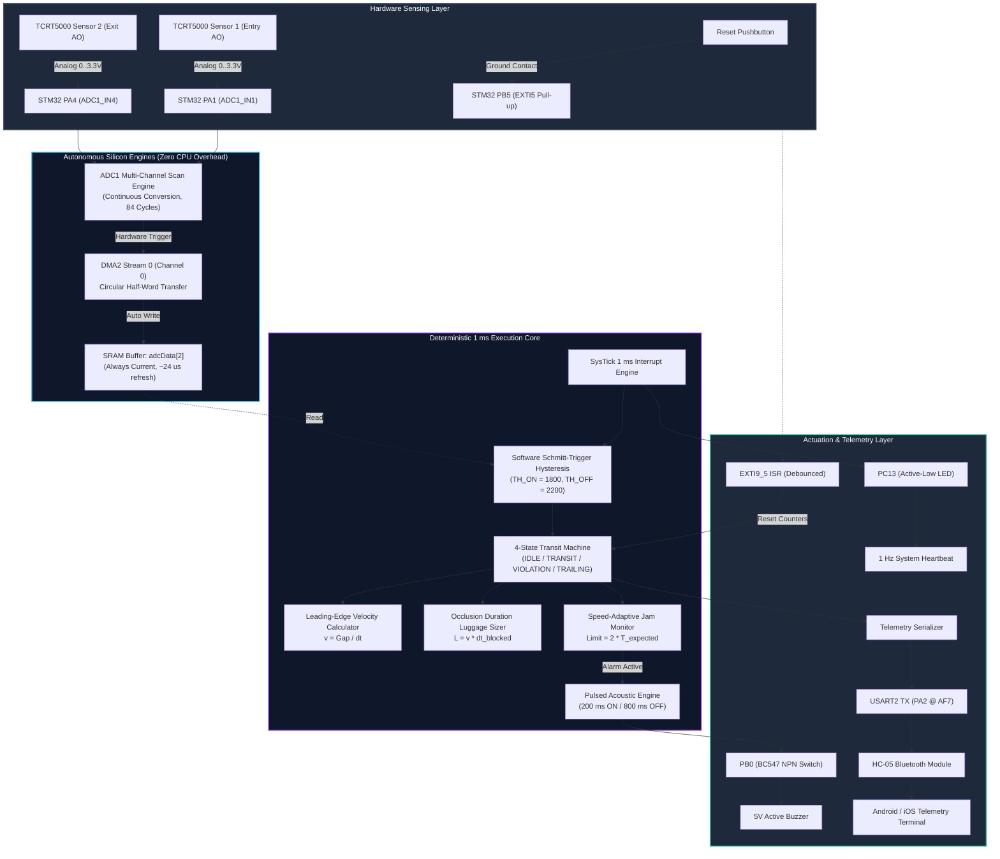
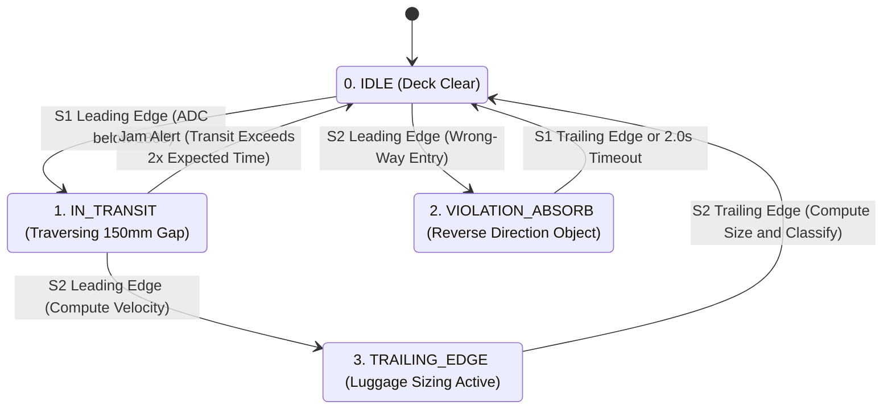

## Academic Details

### Student Name(s) and Registration Number(s)

| Student name | Registration number |
|---|---|
| Rohit Varanasi | CB.SC.U4CSE24561 |
| Anish Reddy | CB.SC.U4CSE24524 |
| Sri Ram | CB.SC.U4CSE24564 |
| Tarun | CB.SC.U4CSE24555 |

**Mentor:** Dr. A. Baskar  
**Course:** 23CSE304 – Embedded Systems  
**Department:** Department of Computer Science and Engineering  
**Institution:** School of Computing, Amrita Vishwa Vidyapeetham, Coimbatore, India.

---

# 🧳 Automated Luggage Sizing, Counter & Dynamic Jam Detection System
### *Bare-Metal STM32F401 Embedded Prototype for Smart Airport Conveyor Lines*

[-002B49.svg?logo=stmicroelectronics)](https://www.st.com/en/microcontrollers-microprocessors/stm32f401cc.html)
[](https://developer.arm.com/Processors/Cortex-M4)
[-brightgreen.svg)](#8-register-by-register-firmware-architecture)
[](https://www.keil.com/)
[](#8-register-by-register-firmware-architecture)
[-blueviolet.svg)](#10-bluetooth-telemetry-protocol)
[-informational.svg)](#)

---

## 📑 Table of Contents
1. [Executive Summary](#1-executive-summary)
2. [Evaluator Defense: Prototype Test Rig vs. Industrial Conveyor](#2-evaluator-defense-prototype-test-rig-vs-industrial-conveyor)
3. [Core Engineering Principles & Mathematics](#3-core-engineering-principles--mathematics)
   - [3.1 Single Honest Speed Measurement](#31-single-honest-speed-measurement)
   - [3.2 Camera-less Luggage Sizing via Optical Occlusion](#32-camera-less-luggage-sizing-via-optical-occlusion)
   - [3.3 Luggage Spacing Dynamics & Live Operator Alerts](#33-luggage-spacing-dynamics--live-operator-alerts)
   - [3.4 Speed-Adaptive Dynamic Jam Detection](#34-speed-adaptive-dynamic-jam-detection)
   - [3.5 Directional Security Violation Detection](#35-directional-security-violation-detection)
4. [End-to-End System Architecture](#4-end-to-end-system-architecture)
5. [Hardware Bill of Materials (BOM)](#5-hardware-bill-of-materials-bom)
6. [Pinout & Electrical Interfacing](#6-pinout--electrical-interfacing)
   - [6.1 Complete Pinout Table](#61-complete-pinout-table)
   - [6.2 Critical Electrical Safety Rule (3.3V vs 5V Analog Rail)](#62-critical-electrical-safety-rule-33v-vs-5v-analog-rail)
   - [6.3 Breadboard Dual-Rail Power Distribution](#63-breadboard-dual-rail-power-distribution)
   - [6.4 Transistor Buzzer Driver & Bluetooth Interconnect](#64-transistor-buzzer-driver--bluetooth-interconnect)
7. [Deterministic 4-State Machine Sequencer](#7-deterministic-4-state-machine-sequencer)
8. [Register-by-Register Firmware Architecture](#8-register-by-register-firmware-architecture)
   - [8.1 Clock Gating (`RCC`)](#81-clock-gating-rcc)
   - [8.2 General Purpose I/O (`GPIO`)](#82-general-purpose-io-gpio)
   - [8.3 Analog-to-Digital Converter (`ADC1`)](#83-analog-to-digital-converter-adc1)
   - [8.4 Direct Memory Access (`DMA2 Stream 0`)](#84-direct-memory-access-dma2-stream-0)
   - [8.5 Deterministic 1 ms SysTick Engine (`SysTick`)](#85-deterministic-1-ms-systick-engine-systick)
   - [8.6 Asynchronous External Interrupt (`EXTI5`)](#86-asynchronous-external-interrupt-exti5)
   - [8.7 Serial Telemetry Transceiver (`USART2`)](#87-serial-telemetry-transceiver-usart2)
9. [Bluetooth Telemetry Protocol & Data Format](#9-bluetooth-telemetry-protocol--data-format)
10. [Keil µVision 5 Build & Toolchain Setup](#10-keil-µvision-5-build--toolchain-setup)
11. [Step-by-Step Live Demonstration Protocol](#11-step-by-step-live-demonstration-protocol)
12. [Examiner Viva Voce Defense & Deep-Dive Q&A](#12-examiner-viva-voce-defense--deep-dive-qa)
13. [Repository File Map](#13-repository-file-map)

---

## 1. Executive Summary

In commercial airport automated baggage handling systems (BHS), high-speed sortation conveyors process thousands of luggage items per hour. These facilities require deterministic, low-latency embedded controllers to continuously track transit velocity, verify dimensional clearances, sort baggage into aircraft hold tiers, dynamically detect blockages, and prevent catastrophic belt jams.

This project implements a complete, industrial-grade **Automated Baggage Sizing, Counting, Spacing, and Jam Detection Controller** executed entirely in **bare-metal C** (using direct CMSIS register access `#include "stm32f4xx.h"` — no HAL, no LL, and no CubeMX) on an **ARM Cortex-M4 (STM32F401CCU6 Black Pill)** microcontroller.

### Key Highlights
- **100% Bare-Metal CMSIS:** Maximum timing determinism, minimal memory footprint (< 4 KB ROM), and direct register manipulation.
- **Hardware ADC + DMA Engine:** Dual-channel scan conversion on `ADC1` paired with `DMA2 Stream 0` in circular mode provides non-blocking, zero-CPU background analog sampling of two optical sensors in ~24 µs.
- **Microsecond Timing Engine:** A 1 ms deterministic `SysTick` interrupt drives all hysteresis filtering, optical edge detection, speed calculation, luggage length sizing, and jam timeout supervision.
- **Camera-less Dimensional Sizing:** Deduces exact physical object length from transit speed and optical occlusion duration ($L = v \times \Delta t$), classifying objects into Carry-on (`SM`), Standard Hold (`ST`), or Oversized (`LG`).
- **Dynamic Jam Detection:** Replaces crude static timers with an adaptive speed-dependent timeout ($2 \times T_{\text{expected}}$), detecting jams within ~300 ms while retaining a 10 s failsafe line stall alert.
- **Security Violation Rejection:** Automatically identifies and isolates reverse-direction transits ($S_2 \rightarrow S_1$) without corrupting forward batch metrics.
- **Wireless Telemetry:** Real-time CSV telemetry streamed at 9600 baud via HC-05 Bluetooth to a companion mobile terminal.

---

## 2. Evaluator Defense: Prototype Test Rig vs. Industrial Conveyor

> [!IMPORTANT]
> ### 🎓 Key Oral Examination Defense
> When presenting this project to examiners and evaluators, use the following rigorous engineering justification:

* **Q: Why did you construct a 45° inclined gravity chute with rolling balls instead of using a motorized chain/belt conveyor?**  
  **A:** *"In an operational airport terminal, baggage is propelled along motorized chain and belt conveyors driven by variable-frequency drives (VFDs). Because an industrial multi-meter conveyor chain was physically inaccessible in our undergraduate laboratory, we engineered a precision 45° inclined cardboard chute where test balls roll freely under gravitational acceleration to simulate continuous luggage transit.  
  Crucially, the underlying real-time embedded systems architecture—**multi-channel continuous ADC1 scan with DMA2 circular transfers, 1 ms SysTick timing engine, EXTI external button interrupt, velocity computation, luggage length sizing, and dynamic jam detection**—is **100% IDENTICAL** to an industrial conveyor controller."*

* **Q: Why is there no rotating thread or lead-screw drive?**  
  **A:** *"A rotating lead screw or threaded rod introduces artificial mechanical friction, backlash, vibration, and unnatural start-stop dynamics that do not reflect smooth conveyor motion. The 45° gravity inclined plane allows objects of varied dimensions to transit naturally and repeatably, producing sharp, clean optical leading- and trailing-edge pulses without mechanical artifacts."*

* **Q: Why does the system not vary a motor speed to manage luggage spacing?**  
  **A:** *"In modern airport baggage induction systems, luggage spacing is managed by controlling the injection/release interval of bags at the induction feeder rather than continually altering main trunk line belt speeds. We reflect this exact dynamic: the operator releases items with specific time intervals based on bag size. The system measures this release gap, computes transit velocity, and displays live spacing guidance (`[ALERT] HIGH SPACING REQ` for oversized bags, `[INFO] LOW SPACING REQ` for carry-ons) directly on the mobile supervisory terminal."*

---

## 3. Core Engineering Principles & Mathematics

```
                45° Gravity-Fed Chute / Conveyor Simulation
      [Luggage Induction Point]
                 \
                  \  (Rolling object under gravity)
                   \
               [ SENSOR 1 ]  ◄── PA1 (ADC1_IN1)  Entry Optical Gate
                    \
                     \  ◄────  BELT_GAP_MM = 150 mm  ────►
                      \
                  [ SENSOR 2 ]  ◄── PA4 (ADC1_IN4)  Exit Optical Gate
                       \
                        \
                    [ EXIT ]
```

### 3.1 Single Honest Speed Measurement
Unlike naïve multi-sensor setups where speed is corrupted by object length, this system computes transit velocity strictly from the **leading edge** of Sensor 1 to the **leading edge** of Sensor 2:

$$
v = \frac{\text{BELT\_GAP\_MM} \times 1000}{t_{S2\text{\_entry}} - t_{S1\text{\_entry}}} \quad \left[\text{mm/s}\right]
$$

Because both timestamps are captured at the exact instant the front boundary of the object breaks each optical beam, the object's physical dimension cancels out completely:

$$
\Delta t_{\text{transit}} = \frac{D_{\text{gap}}}{v} \implies v \text{ is strictly independent of object length/diameter.}
$$

### 3.2 Camera-less Luggage Sizing via Optical Occlusion
Once velocity $v$ is established as the object spans the calibrated gap ($\text{BELT\_GAP\_MM} = 150\text{ mm}$), the firmware tracks the beam occlusion duration $\Delta t_{\text{blocked}}$ across Sensor 2 (from leading edge to trailing edge):

$$
\text{Length (mm)} = \frac{v \times \left(t_{S2\text{\_exit}} - t_{S2\text{\_entry}}\right)}{1000}
$$

Because length is derived in physical millimetres rather than raw time, **classification is completely invariant to speed changes**: a fast-rolling suitcase and a slow-rolling suitcase of identical size receive the exact same classification.

| Category Code | Classification | Physical Dimension | Test Rig Equivalent |
|:---:|:---|:---:|:---|
| **`SM`** | Carry-on / Hand Luggage | $\text{Length} < 50\text{ mm}$ | Small Test Ball |
| **`ST`** | Standard Hold Luggage | $50\text{ mm} \le \text{Length} \le 120\text{ mm}$ | Medium Test Ball |
| **`LG`** | Oversized Baggage | $\text{Length} > 120\text{ mm}$ | Large Test Ball |

### 3.3 Luggage Spacing Dynamics & Live Operator Alerts
In high-throughput sorting hubs, oversized bags require larger inter-bag spacing buffers to prevent jamming in high-speed diverter pushers:
- **`LG` (> 120 mm):** Mobile terminal triggers `[ALERT] HIGH SPACING REQ` (requires larger release gaps).
- **`SM` (< 50 mm):** Mobile terminal displays `[INFO] LOW SPACING REQ` (permits tighter release packing density).
- **`ST` (50–120 mm):** Mobile terminal displays `NORMAL SPACING`.

### 3.4 Speed-Adaptive Dynamic Jam Detection
Static jam timers (e.g., fixed 10-second delays) fail in modern automation: on a slow line they alarm prematurely, while on a high-speed line a catastrophic physical pileup occurs seconds before an alarm sounds.

Our controller calculates the expected transit time dynamically from the current transit velocity:

$$
T_{\text{expected}} = \frac{\text{BELT\_GAP\_MM} \times 1000}{v} \quad \left[\text{ms}\right]
$$

The dynamic jam threshold is set to twice the expected arrival time:

$$
T_{\text{jam\_limit}} = 2 \times T_{\text{expected}}
$$

* On our test rig, a typical transit is $\approx 150\text{ ms}$, triggering an acoustic jam alert within $\approx 300\text{ ms}$ if the object stalls between sensors.
* A secondary 10-second static fallback timer (`TIMEOUT_MS = 10000`) monitors complete conveyor standstill or sensor failure when no speed data can be computed.

### 3.5 Directional Security Violation Detection
In airport baggage claim and sterile security zones, items moving backwards represent a critical security breach (e.g., unauthorized baggage pushback or manual tampering). If Sensor 2 triggers while the state machine is in `STATE_IDLE`, the system increments a dedicated `violations` counter, enters `STATE_VIOLATION_ABSORB`, pulses an alert, and isolates the event so reverse motion never corrupts forward bag counts.

---

## 4. End-to-End System Architecture



---

## 5. Hardware Bill of Materials (BOM)

| Item | Specification / Model | Qty | Electrical Rating | Function in System |
|:---|:---|:---:|:---:|:---|
| **Microcontroller** | STM32F401CCU6 "Black Pill" | 1 | 3.3V Core, 5V VBUS in | ARM Cortex-M4 32-bit MCU running bare-metal firmware |
| **Programmer** | ST-LINK/V2 SWD Programmer | 1 | 3.3V Logic (SWDIO/SWCLK) | Flash programming and hardware register debugging |
| **Optical Sensors** | TCRT5000 Reflective IR Modules | 2 | **3.3V VCC ONLY**, Analog `AO` | Entry and exit leading/trailing edge detection gates |
| **Bluetooth Transceiver** | HC-05 Breakout Module | 1 | 5V VCC, 3.3V UART Levels | Wireless telemetry transmission (USART2 @ 9600 baud) |
| **Acoustic Alarm** | 5V Active Piezo Buzzer | 1 | 5V DC, $\approx 30\text{ mA}$ | Acoustic alert for jam timeouts and line stalls |
| **Transistor Switch** | BC547 or 2N2222 NPN | 1 | $V_{CEO} = 45\text{V}, I_C = 100\text{ mA}$ | Current driver interfacing 3.3V PB0 to 5V 30mA buzzer |
| **Base Resistor** | 1 kΩ ¼W Carbon Film | 1 | $\approx 2.6\text{ mA}$ base drive | Limits PB0 current into BC547 base into full saturation |
| **Reset Pushbutton** | 6 mm Momentary Tactile Switch | 1 | Ground contact | Triggers `EXTI5` asynchronous counter reset |
| **Mechanical Test Rig** | Cardboard Chute (45° incline) | 1 | $150\text{ mm}$ physical sensor gap | Gravity feed simulating industrial conveyor movement |
| **Luggage Specimens** | Varied Diameter Balls (3 sizes) | 3+ | $<50\text{ mm}, 50\text{-}120\text{ mm}, >120\text{ mm}$ | Simulates carry-on, standard hold, and oversized bags |
| **Breadboard & Wires** | Full-size MB-102 + Jumpers | 1 | M-M & M-F Jumpers | Circuit interconnect and dual-rail distribution |
| **Power Source** | Standard USB-C Cable | 1 | 5V DC @ 500mA from PC / Bank | Supplies entire rig via onboard LDO (no external PSU needed) |

---

## 6. Pinout & Electrical Interfacing

### 6.1 Complete Pinout Table

| Black Pill Pin | Alternate Function | Connected Peripheral | Signal Description | Electrical Characteristics |
|:---|:---|:---|:---|:---|
| **`PA1`** | `ADC1_IN1` | TCRT5000 Sensor 1 (Entry) | Analog Phototransistor Output `AO` | $0.0\text{ V} - 3.3\text{ V}$ Analog (Software Hysteresis) |
| **`PA4`** | `ADC1_IN4` | TCRT5000 Sensor 2 (Exit) | Analog Phototransistor Output `AO` | $0.0\text{ V} - 3.3\text{ V}$ Analog (Software Hysteresis) |
| **`PA2`** | `USART2_TX` (AF7) | HC-05 Bluetooth Module | Serial TX Data to HC-05 **RXD** | 3.3V CMOS Logic, 9600 Baud, 8N1 |
| **`PA3`** | `USART2_RX` (AF7) | HC-05 Bluetooth Module | Serial RX Data from HC-05 **TXD** | 3.3V CMOS Logic (Unused in unidirectional telemetry) |
| **`PA5` / `PB0`** | GPIO Output (Open-Drain / Push-Pull) | Buzzer Trigger Control | PA5 (Open-Drain Active-Low) or PB0 (NPN Active-High) |
| **`PB5`** | GPIO Input + `EXTI5` | Momentary Tactile Button | Counter Reset Interrupt | Internal Pull-Up enabled (`PUPDR=01`), Shorts to GND |
| **`PC13`** | GPIO Output | Onboard Blue LED | Heartbeat Monitor | Active Low (Toggles every 1000 ms in SysTick) |
| **`3V3`** | Board Power Output | Both TCRT5000 Sensors | Module $V_{CC}$ Supply | Regulated 3.3V from onboard RT9193 LDO ($\approx 50\text{ mA}$) |
| **`5V`** | USB VBUS Direct Pin | HC-05 $V_{CC}$, Buzzer (+) | High-Current Supply Rail | Direct 5V from USB port ($\approx 80\text{ mA}$ peak load) |
| **`GND`** | System Ground | Common Ground Bus | Common Reference Ground | Tied across all modules and breadboard rails |
| **`PA13 / PA14`** | `SWDIO / SWCLK` | ST-LINK/V2 Dongle | Serial Wire Debug & Flash | Target programming leads (Leave ST-LINK 3.3V pin open) |

---

### 6.2 Critical Electrical Safety Rule (3.3V vs 5V Analog Rail)

> [!CAUTION]
> ### ⚡ PERMANENT HARDWARE DAMAGE WARNING
> **Power the TCRT5000 IR sensor modules strictly from the `3V3` rail, NEVER from the `5V` rail.**
>
> While many digital GPIO pins on the STM32F401 are 5V-tolerant (FT) when operating as standard digital inputs, **pins configured in Analog Mode (`MODER = 11`) completely bypass the internal 5V clamp and protection structures**. 
> 
> If a TCRT5000 module is powered from 5V, its analog output pin (`AO`) will swing up to $\approx 4.6\text{ V}$ when reflecting off light surfaces. Applying $> 3.6\text{ V}$ directly to `PA1` or `PA4` will induce silicon substrate latch-up, distort concurrent ADC readings across other channels, and permanently burn out the ADC input multiplexer.
>
> *Running the modules at 3.3V keeps the maximum analog swing safely within the MCU's $0 - 3.3\text{ V}$ reference range without requiring external resistor dividing networks.*

---

### 6.3 Breadboard Dual-Rail Power Distribution

The entire system is powered from a single USB-C cable plugged into the STM32 Black Pill. The board provides both required supply rails naturally:
- **`5V` Pin (VBUS):** Feeds the HC-05 Bluetooth module (requires $\ge 3.6\text{ V}$ to clear internal LDO dropout) and the 5V active buzzer.
- **`3V3` Pin (LDO Output):** Feeds the Black Pill MCU core and both TCRT5000 analog sensors.

```
       BREADBOARD POWER TOPOLOGY (Single USB-C Cable Supply)
       ====================================================
           [ USB-C Cable (5V from Laptop or Power Bank) ]
                               │
                               ▼
                    [ STM32F401 Black Pill ]
                    │                      │
             (5V Pin: Direct VBUS)   (3V3 Pin: Regulated LDO)
                    │                      │
                    ▼                      ▼
           [ Top Breadboard Rail ]  [ Bottom Breadboard Rail ]
              (+) 5.0V Rail            (+) 3.3V Rail
              (-) GND  Rail            (-) GND  Rail
                    │                      │
         ┌──────────┴──────────┐           ├─────────────────────┐
         ▼                     ▼           ▼                     ▼
    HC-05 Bluetooth       5V Buzzer   TCRT5000 Sensor 1     TCRT5000 Sensor 2
       (VCC Pin)           (+) Pin        (VCC Pin)             (VCC Pin)
                                           
        ▲ COMMON GROUND JUMPER: Top (-) Rail tied to Bottom (-) Rail ▲
```

---

### 6.4 Transistor Buzzer Driver & Bluetooth Interconnect

#### Buzzer Drive Circuitry
An active 5V buzzer draws $\approx 30\text{ mA}$, which exceeds the maximum recommended single-pin source current ($\approx 20\text{ mA}$) and cannot be driven to full loudness from a 3.3V logic level. A standard BC547 NPN transistor acts as a low-side saturation switch:

```
  +5V Rail ───────┬───────────────────────────────┐
                  │                               │
             [+] Buzzer                           │
             [-] Active 5V                        │
                  │                          [1N4148 Diode]
                  ├───────────────────────────────┘ (Optional flyback)
                  │ Collector
               ┌──┴──┐
PB0 ──[ 1 kΩ ]─┤ BC547│ NPN
               └──┬──┘
                  │ Emitter
  GND Rail ───────┴───────────────────────────────
```

#### Bluetooth UART Interconnect
The HC-05 radio communicates via asynchronous serial UART:
- **STM32 `PA2` (`USART2_TX`)** $\longrightarrow$ **HC-05 `RXD`** (3.3V logic level directly compatible; no resistor divider required).
- **STM32 `PA3` (`USART2_RX`)** $\longleftarrow$ **HC-05 `TXD`** (3.3V output from HC-05).
- *Note:* Do not connect the HC-05 `EN` / `KEY` pin; holding it high forces 38400 baud AT command mode. Leave it floating for automatic 9600 baud transparent data transmission.

---

## 7. Deterministic 4-State Machine Sequencer

The core tracking engine is implemented as a non-blocking, deterministic finite state machine (FSM) evaluated every 1 ms inside `SysTick_Handler`:



### State Definitions & Trigger Criteria

| State | Enumeration | Active Condition | Exit Trigger & Action |
|:---:|:---|:---|:---|
| **0** | `STATE_IDLE` | Both optical beams clear. Monitoring deck. | **S1 Leading Edge ($ADC < 1800$):** Timestamp $t_{S1\text{\_entry}}$, transition to `STATE_IN_TRANSIT`.<br/>**S2 Leading Edge ($ADC < 1800$):** Reverse violation detected, transition to `STATE_VIOLATION_ABSORB`. |
| **1** | `STATE_IN_TRANSIT` | Luggage is actively spanning the 150 mm physical gap. | **S2 Leading Edge ($ADC < 1800$):** Timestamp $t_{S2\text{\_entry}}$, calculate velocity $v$, transition to `STATE_TRAILING_EDGE`.<br/>**Dynamic Jam Timeout ($t > 2 \times T_{\text{expected}}$):** Trigger buzzer, record jam alarm, abort to `STATE_IDLE`. |
| **2** | `STATE_VIOLATION_ABSORB` | Reverse object moving backward ($S_2 \rightarrow S_1$). | **S1 Trailing Edge or 2.0 s Timeout:** Security violation recorded in telemetry; returns to `STATE_IDLE` without incrementing bag counts. |
| **3** | `STATE_TRAILING_EDGE` | Luggage actively occluding Sensor 2 exit gate. | **S2 Trailing Edge ($ADC > 2200$):** Calculate beam occlusion duration $\Delta t_{\text{blocked}}$, compute length in mm, categorize (`SM`/`ST`/`LG`), transmit Bluetooth telemetry, return to `STATE_IDLE`. |

---

## 8. Register-by-Register Firmware Architecture

All firmware is written in strict bare-metal C without HAL, LL, or CubeMX dependencies. Every hardware register write is documented below matching [`src/main.c`](file:///c:/Users/varan/OneDrive/Desktop/5thsem/es_case_study/src/main.c).

### 8.1 Clock Gating (`RCC`)
Before any peripheral register can be modified, its dedicated bus clock must be enabled in the Reset and Clock Control (`RCC`) subsystem:
```c
/* Enable AHB1 peripheral clocks for GPIOA, GPIOB, GPIOC, and DMA2 */
RCC->AHB1ENR |= (1U << 0);   /* Bit 0:  GPIOA clock enable */
RCC->AHB1ENR |= (1U << 1);   /* Bit 1:  GPIOB clock enable */
RCC->AHB1ENR |= (1U << 2);   /* Bit 2:  GPIOC clock enable */
RCC->AHB1ENR |= (1U << 22);  /* Bit 22: DMA2 clock enable */

/* Enable APB2 peripheral clocks for ADC1 and System Configuration (SYSCFG) */
RCC->APB2ENR |= (1U << 8);   /* Bit 8:  ADC1 clock enable */
RCC->APB2ENR |= (1U << 14);  /* Bit 14: SYSCFG clock enable (required for EXTI routing) */

/* Enable APB1 peripheral clock for USART2 */
RCC->APB1ENR |= (1U << 17);  /* Bit 17: USART2 clock enable */
```

---

### 8.2 General Purpose I/O (`GPIO`)
Each pin's operating mode is configured via its 2-bit field in `GPIOx->MODER` (`00`=Input, `01`=Output, `10`=Alternate Function, `11`=Analog):
```c
/* Configure PA1 and PA4 as Analog Mode (11b) for ADC1 Channels 1 & 4 */
GPIOA->MODER |= (3U << (1 * 2));   /* PA1 = Analog */
GPIOA->MODER |= (3U << (4 * 2));   /* PA4 = Analog */

/* Configure PA2 and PA3 as Alternate Function Mode (10b) for USART2 */
GPIOA->MODER &= ~((3U << (2 * 2)) | (3U << (3 * 2)));
GPIOA->MODER |=  ((2U << (2 * 2)) | (2U << (3 * 2)));

/* Route PA2 and PA3 to AF7 (USART2) via Alternate Function Low Register AFR[0] */
GPIOA->AFR[0] &= ~((0xFU << (2 * 4)) | (0xFU << (3 * 4)));
GPIOA->AFR[0] |=  ((7U  << (2 * 4)) | (7U  << (3 * 4)));

/* Configure PB0 (Buzzer) and PC13 (Heartbeat LED) as Push-Pull Outputs (01b) */
GPIOB->MODER &= ~(3U << (0 * 2));
GPIOB->MODER |=  (1U << (0 * 2));   /* PB0 = Output */
GPIOC->MODER &= ~(3U << (13 * 2));
GPIOC->MODER |=  (1U << (13 * 2));  /* PC13 = Output */

/* Configure PB5 as Digital Input (00b) with Internal Pull-Up for Pushbutton */
GPIOB->MODER &= ~(3U << (5 * 2));   /* PB5 = Input */
GPIOB->PUPDR &= ~(3U << (5 * 2));
GPIOB->PUPDR |=  (1U << (5 * 2));   /* PUPDR[11:10] = 01b (Pull-up) */
```

---

### 8.3 Analog-to-Digital Converter (`ADC1`)
Instead of reading 1-bit digital trimpots (`DO`), `ADC1` samples the continuous analog voltage (`AO`) from both sensors:
```c
/* Set ADC Clock Prescaler to divide by 4 (APB2 16 MHz / 4 = 4 MHz ADC clock) */
ADC->CCR &= ~(3U << 16);
ADC->CCR |=  (1U << 16);   /* ADC_CCR_ADCPRE = 01b (/4) */

/* Configure Scan Mode, 12-bit Resolution, Continuous Conversion, and DMA triggers */
ADC1->CR1 |= (1U << 8);    /* SCAN: Scan mode enabled (converts Ch1 then Ch4) */
ADC1->CR2 |= (1U << 1);    /* CONT: Continuous conversion mode */
ADC1->CR2 |= (1U << 8);    /* DMA:  Enable DMA requests from ADC */
ADC1->CR2 |= (1U << 9);    /* DDS:  DMA requests continue in circular mode */

/* Set Sample Time to 84 cycles for Channel 1 and Channel 4 (stable high-impedance read) */
ADC1->SMPR2 |= (4U << (1 * 3)) | (4U << (4 * 3));  /* SMPR2: 100b = 84 cycles */

/* Configure Regular Sequence: Sequence Length = 2 conversions */
ADC1->SQR1 &= ~(0xFU << 20);
ADC1->SQR1 |=  (1U   << 20);   /* L[3:0] = 1 (2 conversions) */
ADC1->SQR3 = (1U << 0) | (4U << 5);  /* 1st = Ch 1 (PA1), 2nd = Ch 4 (PA4) */

/* Enable ADC1 */
ADC1->CR2 |= (1U << 0);    /* ADON = 1 */
```

---

### 8.4 Direct Memory Access (`DMA2 Stream 0`)
`ADC1` features only a single 16-bit data register (`ADC_DR`). In scan mode, Channel 1 converts in $\approx 24\ \mu\text{s}$, followed immediately by Channel 4, which overwrites `ADC_DR`. No interrupt or main-loop polling can reliably retrieve both values before data corruption occurs.

`DMA2 Stream 0` offloads this entirely to hardware:
```c
/* Ensure DMA2 Stream 0 is disabled before updating configuration */
DMA2_Stream0->CR &= ~(1U << 0);
while (DMA2_Stream0->CR & (1U << 0)) { /* Wait for stream to abort */ }

/* Clear all interrupt flags for Stream 0 in Low Interrupt Flag Clear Register */
DMA2->LIFCR = 0x3D;

/* Set Source Address: ADC1 Data Register */
DMA2_Stream0->PAR = (uint32_t)&(ADC1->DR);

/* Set Destination Address: Global SRAM array uint16_t adcData[2] */
DMA2_Stream0->M0AR = (uint32_t)adcData;

/* Number of data items to transfer per circular pass: 2 half-words */
DMA2_Stream0->NDTR = 2;

/* Stream Configuration: Channel 0, Peripheral-to-Memory, Half-Word, Circular */
DMA2_Stream0->CR = 0;
DMA2_Stream0->CR |= (0U << 25);  /* CHSEL = 0 (ADC1 is mapped to Channel 0) */
DMA2_Stream0->CR |= (1U << 8);   /* CIRC  = 1 (Continuous circular reload) */
DMA2_Stream0->CR |= (1U << 10);  /* MINC  = 1 (Increment memory pointer to adcData[1]) */
DMA2_Stream0->CR |= (1U << 11);  /* PSIZE = 01b (16-bit peripheral data size) */
DMA2_Stream0->CR |= (1U << 13);  /* MSIZE = 01b (16-bit memory data size) */
DMA2_Stream0->CR |= (0U << 6);   /* DIR   = 00b (Peripheral-to-memory) */

/* Enable DMA2 Stream 0 */
DMA2_Stream0->CR |= (1U << 0);   /* EN = 1 */

/* Trigger ADC Software Start of Conversion */
ADC1->CR2 |= (1U << 30);         /* SWSTART = 1 */
```
*Result:* `adcData[0]` (Sensor 1) and `adcData[1]` (Sensor 2) update continuously in SRAM with **0% CPU utilization**.

---

### 8.5 Deterministic 1 ms SysTick Engine (`SysTick`)
The ARM Cortex-M4 core SysTick timer is clocked from the 16 MHz internal HSI oscillator:
```c
/* Set reload register for exactly 1 ms interrupt tick: (16,000,000 / 1000) - 1 */
SysTick->LOAD = 16000 - 1;
SysTick->VAL  = 0;
SysTick->CTRL = SysTick_CTRL_CLKSOURCE_Msk |  /* Processor clock (16 MHz) */
                SysTick_CTRL_TICKINT_Msk   |  /* Enable SysTick interrupt */
                SysTick_CTRL_ENABLE_Msk;       /* Start timer counter */
```

#### Software Schmitt-Trigger Hysteresis Filter
Inside `SysTick_Handler()`, raw analog values are filtered with dual threshold hysteresis to eliminate edge chatter caused by ambient optical noise:
```c
/* Sensor 1 (Entry Gate) Hysteresis */
if (adcData[0] < 1800) {
    s1State = 1;  /* BEAM BLOCKED (Object detected, IR reflected) */
} else if (adcData[0] > 2200) {
    s1State = 0;  /* BEAM CLEAR (Ambient deck background) */
}

/* Sensor 2 (Exit Gate) Hysteresis */
if (adcData[1] < 1800) {
    s2State = 1;  /* BEAM BLOCKED */
} else if (adcData[1] > 2200) {
    s2State = 0;  /* BEAM CLEAR */
}
```

---

### 8.6 Asynchronous External Interrupt (`EXTI5`)
A physical momentary pushbutton on `PB5` resets the total counted bags and directional violations:
```c
/* Map PB5 to EXTI line 5 in System Configuration External Interrupt Register */
SYSCFG->EXTICR[1] &= ~(0xFU << 4);
SYSCFG->EXTICR[1] |=  (1U   << 4);   /* Port B selected for EXTI5 */

/* Configure Falling Edge Trigger (Button press pulls PB5 low to GND) */
EXTI->FTSR |= (1U << 5);   /* Falling edge trigger enabled */
EXTI->RTSR &= ~(1U << 5);  /* Rising edge trigger disabled */

/* Unmask EXTI Line 5 */
EXTI->IMR |= (1U << 5);

/* Enable and prioritize EXTI Line [9:5] vector in ARM NVIC */
NVIC_SetPriority(EXTI9_5_IRQn, 2);
NVIC_EnableIRQ(EXTI9_5_IRQn);
```

---

### 8.7 Serial Telemetry Transceiver (`USART2`)
`USART2` is configured for asynchronous 8N1 transmission at 9600 baud directly over `PA2`:
```c
/* Calculate Baud Rate Register (BRR) for 9600 baud at 16 MHz APB1 clock:
   USARTDIV = 16,000,000 / (16 * 9600) = 104.1666
   Mantissa = 104 = 0x68, Fraction = 0.1666 * 16 = 2.66 -> 3 = 0x3
   BRR = 0x0683 */
USART2->BRR = 0x0683;

/* Enable Transmitter (TE) and USART2 Peripheral (UE) */
USART2->CR1 |= (1U << 3);   /* TE = 1 (Transmitter enable) */
USART2->CR1 |= (1U << 13);  /* UE = 1 (USART enable) */
```

---

## 9. Bluetooth Telemetry Protocol & Data Format

The microcontroller streams structured CSV ASCII strings over Bluetooth (HC-05 on `USART2`) to any serial terminal app (e.g., *Serial Bluetooth Terminal* on Android or *BLE Terminal* on iOS) at **9600 Baud, 8 Data Bits, No Parity, 1 Stop Bit (8N1)**.

### Telemetry Packet Structure
```
B,<total>,<speed_mm_s>,<length_mm>,<category>,<belt_status>,<violations>\r\n
```

| Field Index | Field Identifier | Data Type | Example Value | Description |
|:---:|:---|:---:|:---:|:---|
| **0** | Header | String | `B` | Telemetry packet sync header |
| **1** | `<total>` | Integer | `14` | Total valid forward bags counted since boot/reset |
| **2** | `<speed_mm_s>` | Integer | `845` | Calculated transit velocity in $\text{mm/s}$ |
| **3** | `<length_mm>` | Integer | `78` | Derived luggage length / ball diameter in $\text{mm}$ |
| **4** | `<category>` | String | `ST` | Luggage category: `SM` (Carry-on), `ST` (Standard), `LG` (Oversized), `-` (Pending) |
| **5** | `<belt_status>` | Boolean | `0` | System status: `0` = Normal Conveyor Flow, `1` = Jam / Stall Alarm Active |
| **6** | `<violations>` | Integer | `1` | Total directional security violations ($S_2 \rightarrow S_1$) intercepted |

### System Status Packets
- **On Boot / Hardware Reset:** Microcontroller emits `READY\r\n`.
- **On Pushbutton Press (`PB5`):** Microcontroller clears all totals and emits `RESET\r\n`.

```
--- SAMPLE TERMINAL TRACE ---
READY
B,1,852,42,SM,0,0     <-- Carry-on bag (<50mm), normal transit
B,2,810,88,ST,0,0     <-- Standard hold bag (50-120mm)
B,3,745,145,LG,0,0    <-- Oversized baggage (>120mm), triggers high spacing alert
B,3,0,0,-,1,0         <-- JAM ALARM: Ball blocked Sensor 1 without reaching Sensor 2
B,3,0,0,-,0,1         <-- DIRECTIONAL VIOLATION: Reverse pushback detected
RESET
B,0,0,0,-,0,0         <-- Counters cleared to zero via pushbutton
```

---

## 10. Keil µVision 5 Build & Toolchain Setup

Follow these exact steps to compile and flash the firmware onto the STM32F401CCU6 Black Pill:

1. **Launch Keil µVision 5** and navigate to `Project` $\rightarrow$ `New µVision Project...`.
2. Name the project `airport_baggage_f401` and save it to the repository directory.
3. In the Device Selection tree, pick:  
   `STMicroelectronics` $\rightarrow$ `STM32F4 Series` $\rightarrow$ `STM32F401` $\rightarrow$ `STM32F401CC` $\rightarrow$ **`STM32F401CCUx`**.
4. The **Manage Run-Time Environment (RTE)** window will appear. Check **ONLY** the following two components:
   - ☑ **`CMSIS` $\rightarrow$ `CORE`**
   - ☑ **`Device` $\rightarrow$ `Startup`**  
   *(Leave all HAL, LL, and Board Support checkboxes strictly unchecked).*
5. Right-click `Target 1` $\rightarrow$ `Source Group 1` $\rightarrow$ `Add Existing Files to Group 'Source Group 1'...` and select [`src/main.c`](file:///c:/Users/varan/OneDrive/Desktop/5thsem/es_case_study/src/main.c).
6. Open **Project Options (`Alt + F7`)**:
   - **`Target` Tab:** Ensure Code Generation uses `ARM Compiler Version 5` or `Version 6`.
   - **`C/C++` Tab:** Set Optimization to **`Level 0 (-O0)`** or **`Level 1 (-O1)`** for clean hardware register debugging.
   - **`Debug` Tab:** In the top-right dropdown, switch from *Simulator* to **`ST-Link Debugger`**.
   - Click **`Settings`** next to ST-Link Debugger:
     - Under **Debug**, verify Port is set to **`SW`** (Serial Wire). The ST-LINK serial number and ARM Core IDCODE should populate.
     - Under **Flash Download**, check the box ☑ **`Reset and Run`** (so the firmware executes immediately after flashing without requiring manual power cycling).
7. Press **`F7` (Build Project)**. The build window must output:  
   `0 Error(s), 0 Warning(s)`.
8. Connect the ST-LINK/V2 SWD leads to the Black Pill (`SWDIO`, `SWCLK`, `GND`) and press **`F8` (Download)** to flash the MCU.

---

## 11. Step-by-Step Live Demonstration Protocol

This 8-step test protocol validates every subsystem requirement during oral defense:

```
+------+--------------------------+------------------------------+---------------------------------------+
| Step | Action Performed         | Hardware Reaction            | Phone Telemetry Terminal Output       |
+------+--------------------------+------------------------------+---------------------------------------+
|  1   | Connect USB Power        | PC13 LED blinks at 1 Hz      | Receives: "READY"                     |
|  2   | Leave Chute Empty (10 s) | Buzzer emits stall alert     | Receives: "B,0,0,0,-,1,0"             |
|  3   | Occlude S1 Only (Hand)   | Buzzer alarms after 2.0 s    | No count increment (Partial rejected) |
|  4   | Roll Small Ball (<50mm)  | Buzzer silent, Count +1      | Receives: "B,1,850,38,SM,0,0"         |
|  5   | Roll Medium Ball         | Count +1, Sizing displayed   | Receives: "B,2,820,85,ST,0,0"         |
|  6   | Roll Large Ball (>120mm) | Count +1, Sizing displayed   | Receives: "B,3,750,140,LG,0,0"        |
|  7   | Roll Ball Reverse (S2->S1)| Alarm chirp, Count unchanged | Receives: "B,3,0,0,-,0,1" (Violation) |
|  8   | Press Pushbutton (PB5)   | Instantaneous register reset | Receives: "RESET" then "B,0,0,0,-,0,0"|
+------+--------------------------+------------------------------+---------------------------------------+
```

---

## 12. Examiner Viva Voce Defense & Deep-Dive Q&A

### Q1: Why use ADC and DMA for digital TCRT5000 sensors instead of reading standard GPIO pins?
> **Answer:**  
> Reading the digital `DO` pin shifts the analog comparison threshold to a mechanical potentiometer on the breakout board, which suffers from thermal drift, vibration shift, and mechanical tampering. By sampling the raw analog `AO` pin via **ADC1**, our detection threshold is locked deterministically in software with digital Schmitt-trigger hysteresis (`TH_ON = 1800`, `TH_OFF = 2200`).  
> Furthermore, `ADC1` has only one single 16-bit data register (`ADC_DR`). When scanning multiple channels, Channel 4 overwrites Channel 1 within 24 µs. **DMA2 Stream 0 in circular mode** is physically required to extract converted channel values directly into SRAM without consuming CPU instruction cycles.

### Q2: Why is the transit velocity calculation immune to object size?
> **Answer:**  
> Speed is computed strictly from the **leading edge** of Sensor 1 to the **leading edge** of Sensor 2. Because both timestamps are captured when the front physical boundary of the ball breaks each optical beam, the object's diameter or length cancels out completely:
> 
> $$v = \frac{D_{\text{gap}}}{t_{S2\text{\_front}} - t_{S1\text{\_front}}}$$
> 
> An oversized suitcase and a small carry-on traversing the gap at identical speeds yield the exact same velocity figure.

### Q3: What prevents edge bouncing or sensor chatter when an object enters the optical beam?
> **Answer:**  
> Dual-layer filtering is implemented:
> 1. **Software Schmitt Hysteresis:** The beam is declared blocked only when the analog read drops below `1800` (~1.45V) and declared clear only when it rises above `2200` (~1.77V).
> 2. **Temporal Blanking:** A 15 ms minimum occlusion time filter (`MIN_DT_MS = 15`) rejects fast ambient optical noise, fluorescent light flicker, and dust particles.

### Q4: What happens if an object rolls backwards down the chute?
> **Answer:**  
> In `STATE_IDLE`, an unexpected trigger on exit Sensor 2 indicates reverse motion ($S_2 \rightarrow S_1$). The FSM transitions to `STATE_VIOLATION_ABSORB`, increments the `violations` metric, and remains in this quarantine state until Sensor 1 clears. This ensures reverse transits can never trigger false forward bag counts or corrupt velocity math.

### Q5: Why is the TCRT5000 module prohibited from being powered by 5V?
> **Answer:**  
> When STM32 pins (`PA1`, `PA4`) are placed in **Analog Mode** (`MODER = 11`), internal digital clamping diodes to $V_{DD}$ are disconnected to prevent non-linear distortion of analog voltages. Consequently, analog mode pins are **not 5V tolerant**. Powering the sensor from 5V would allow its analog output to drive up to ~4.6V, injecting substrate current that damages the ADC input multiplexer.

---

## 13. Repository File Map

```
es_case_study/
├── circuit_diagram.png
├── README.md                                    # ◄── Master Project Documentation (GitHub Landing)
├── src/
│   └── main.c                                   # Complete Bare-Metal C Firmware (Keil µVision 5)
├── circuit_and_wiring_diagrams/
│   ├── 01-complete-wiring.png                   # High-res stage 1 wiring photo
│   ├── 02-sensors-and-bluetooth.png             # Stage 2 sensor & HC-05 layout photo
│   ├── 03-buzzer-and-reset-button.png           # Stage 3 buzzer driver & button photo
│   ├── 04-power-and-programming.png            # Stage 4 ST-LINK & USB power topology photo
│   ├── inclined-plane-layout.png                # High-res mechanical test rig diagram
│   ├── power-wiring.svg                         # Dual-rail USB breadboard distribution diagram
│   ├── preview_wiring_full.png                  # Full breadboard physical wiring preview
│   ├── Smart Airport Baggage Wiring Diagram.png # Complete circuit schematic & pin interconnect
│   └── wiring-diagram.svg                       # Vector electrical connection schematic
├── presentation/
|   ├── Group_8_Automated_Gravity_Fed...pdf      # Official Case Study Defense Slide Deck (PDF)
|   └── Group_8_Automated_Gravity_Fed...pptx     # Executive 16:9 Presentation Deck (PowerPoint)
├── report
|    ├── Report_Group_8.docx
|    └── Report_Group_8.pdf
├── One_page_writeup
|    ├── group_8_One_Page_Project_Writeup.docx
|    └── group_8_One_Page_Project_Writeup.pdf

```

---

### 👨‍💻 Project Authors & Academic Credits
- **Project:** Automated Gravity-Fed Object Counter & Jam Detection System (Smart Airport Baggage Prototype)
- **Course:** 5th Semester Embedded Systems Case Study (Group 8)
- **Target Platform:** ARM Cortex-M4 (STM32F401CCU6 Black Pill)
- **Toolchain:** Keil µVision 5 (Bare-Metal CMSIS C)
