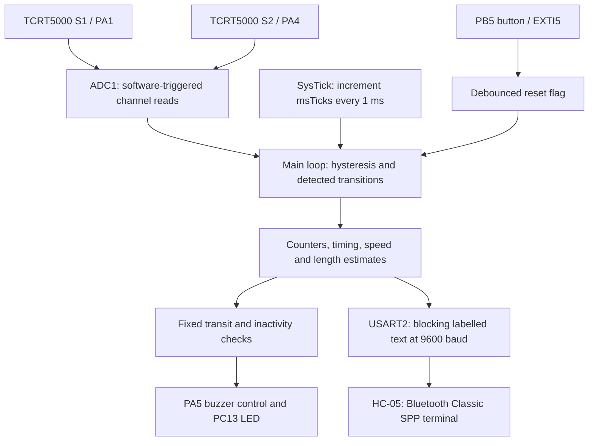
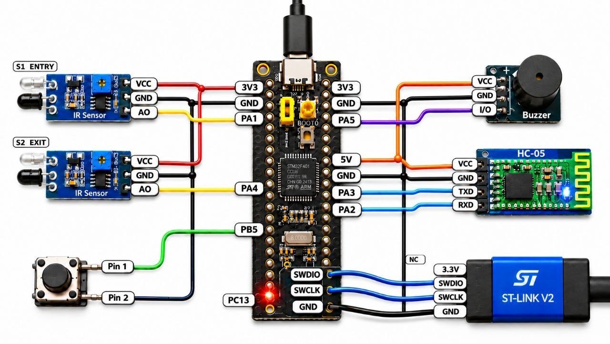

## Academic Details

### Student Name(s) and Registration Number(s)

| Student name | Registration number |
|---|---|
| Rohit Varanasi | CB.SC.U4CSE24561 |
| Anish Reddy | CB.SC.U4CSE24524 |
| Sri Ram | CB.SC.U4CSE24564 |
| Tarun | CB.SC.U4CSE24555 |

**Mentor:** Dr. A. Baskar  
**Course:** 23CSE304 – Embedded Systems  
**Department:** Department of Computer Science and Engineering  
**Institution:** School of Computing, Amrita Vishwa Vidyapeetham, Coimbatore, India.

---

# Automated Gravity-Fed Object Counter and Jam Detection System

**Bare-metal STM32F401CCU6 prototype for airport baggage-conveyor monitoring, with speed and length estimation.**

[Problem statement (PDF)](problem_statement.pdf) · [Firmware](src/main.c) · [Report (PDF)](report/Report_Group_8.pdf) · [Presentation (PDF)](presentation/Group_8_Automated_Gravity_Fed_Object_Counter_and_Jam_Detection_System.pdf) · [One-page write-up (PDF)](One_page_writeup/group_8_One_Page_Project_Writeup.pdf)

This README describes the implementation in [`src/main.c`](src/main.c). The report's Appendix C records the change from an earlier DMA-based design to the current polled implementation. ADC polling, fixed fault windows, PA5 buzzer control, and labelled Bluetooth text are the behaviours implemented in the source.

## Table of Contents

1. [Problem and objectives](#1-problem-and-objectives)
2. [Prototype scope](#2-prototype-scope)
3. [Measurement and fault detection](#3-measurement-and-fault-detection)
4. [System architecture](#4-system-architecture)
5. [Hardware](#5-hardware)
6. [Pinout and electrical interfacing](#6-pinout-and-electrical-interfacing)
7. [Tracking and recovery](#7-tracking-and-recovery)
8. [Firmware and register configuration](#8-firmware-and-register-configuration)
9. [Bluetooth telemetry](#9-bluetooth-telemetry)
10. [Build and programming](#10-build-and-programming)
11. [Demonstration procedure](#11-demonstration-procedure)
12. [Limitations and future work](#12-limitations-and-future-work)
13. [Repository file map](#13-repository-file-map)

## 1. Problem and objectives

An entry detection alone does not confirm that an object has reached the exit of a transport section. An item can become stuck between the two points while an entry counter continues to show that it was detected. Without timely supervision, following items can accumulate and interrupt the flow. Manual observation also makes consistent counting and size assessment difficult.

The project addresses this by tracking entry and exit events, identifying an excessive transit delay, and reporting the condition to an operator. It also estimates object speed and length, assigns a prototype size category, records unexpected exit-side events, and flags inactivity after operation has begun.

The objectives are to:

- Count forward arrivals at the exit sensor and track entries that have not yet reached it.
- Estimate transit speed and object length using two reflective infrared sensors.
- Raise a local jam alert when an entered object takes too long to arrive, then clear it when the pending count returns to zero.
- Provide Bluetooth status, buzzer and LED indications, and a pushbutton reset.
- Demonstrate the sensing and timing logic using direct peripheral-register programming.

See the complete [problem statement](problem_statement.pdf).

## 2. Prototype scope

A 45-degree gravity-fed chute with sensors 150 mm apart models a short baggage-conveyor section. Test balls represent objects of different sizes. This makes entry/exit timing and obstruction scenarios practical to demonstrate without a motorized conveyor.

The controller uses an STM32F401CCU6 Black Pill, bare-metal C, and CMSIS device definitions through `stm32f4xx.h`; the application does not use HAL, LL, or CubeMX. It assumes a 16 MHz system/peripheral clock for its timing constants.

The prototype observes and reports. It does not stop a belt, regulate a motor, enforce object spacing, or physically sort luggage. Demonstrations should use one object at a time: the firmware has a pending-object counter but only one set of measurement timestamps. The size thresholds are laboratory categories, not airline baggage limits.

## 3. Measurement and fault detection

### 3.1 Sensor detection

Both TCRT5000 modules provide analog readings. Software hysteresis changes a sensor from clear to detected below `TH_ON = 1800`, and back to clear above `TH_OFF = 2200`. Between the thresholds, the previous state is retained. These modules detect reflected infrared light; the source uses the name `Blocked` for the detected state.

Thresholds depend on sensor placement, object surface, and ambient conditions. The main loop polls the sensors; their transitions are not captured by hardware edge interrupts.

### 3.2 Transit speed

Let `D = 150 mm` be the sensor separation and let `dt` be the interval in milliseconds between the detected leading edges at S1 and S2:

$$
v_{\text{estimate}} = \frac{D \times 1000}{\Delta t_{\text{transit}}}\quad[\text{mm/s}]
$$

The implementation uses integer arithmetic and updates `speed` only for `15 <= dt <= 2000 ms`. `MIN_DT_MS = 15` is a speed-update condition; it does not reject all short sensor pulses or prevent them from affecting counters.

The result estimates average object speed between the sensors. A rolling object accelerates on the incline, so this is not necessarily its instantaneous speed at the exit.

### 3.3 Length and prototype categories

When the exit sensor clears, its detection duration is combined with the stored speed:

$$
L_{\text{estimate}} = \frac{v_{\text{estimate}} \times \Delta t_{S2}}{1000}\quad[\text{mm}]
$$

| Code | Terminal category | Estimated length |
|---|---|---|
| `SM` | Carry-on | Below 50 mm |
| `ST` | Standard Hold | 50 through 120 mm |
| `LG` | Oversized | Above 120 mm |

This is a one-dimensional estimate. Its accuracy depends on speed during detection, sensor geometry, reflectivity, and when the polling loop observes each transition. It does not establish exact ball diameter, full luggage dimensions, or speed-independent classification under all conditions. No spacing measurement or size-dependent spacing message is implemented.

### 3.4 Jam and inactivity conditions

| Condition | Source rule | Behaviour |
|---|---|---|
| Pending transit | S1 detects a new object | Increment `inTransit` and record the latest entry time. |
| Excessive transit delay | `inTransit > 0` and more than `PAIR_MS = 2000` ms since the latest entry | Set the shared `alert` flag. |
| Delayed arrival/recovery | S2 detects an object while `inTransit > 0` | Increment `total`, decrement `inTransit`, and clear the alert if the pending count reaches zero. |
| Inactivity after operation | `total > 0`, `inTransit == 0`, no alert, and at least `TIMEOUT_MS = 20000` ms since the last counted arrival | Set the alert; telemetry labels it `CONVEYOR STOPPED / IDLE`. |

These are fixed thresholds, evaluated in the main loop. The implemented jam limit is not computed from measured speed, and alarm response can be delayed by blocking transmission. A jam retains the pending count so that a later arrival can still be counted.

The inactivity timer does not alarm on an untouched chute immediately after boot or reset. It measures absence of counted arrivals, not motor rotation; it cannot distinguish an empty running conveyor from a stopped one.

### 3.5 Unexpected exit-side events

If S2 detects an object with `inTransit == 0` and `total > 0`, the firmware increments `violations`. This is a basic indication of possible reverse movement. Before the first counted arrival, this condition is not recorded. There is no reverse-travel absorption state, and a later S1 detection can still increment the pending count. The implementation is not a complete direction classifier or security interlock.

## 4. System architecture



The SysTick interrupt supplies a millisecond counter. Sampling, edge decisions, measurements, alarms, output patterns, and telemetry execute in the main loop. DMA and a four-state enumerated sequencer are not configured in the current source.

## 5. Hardware

| Component | Quantity | Purpose |
|---|---|---|
| STM32F401CCU6 Black Pill | 1 | Microcontroller and USB-powered board |
| TCRT5000 reflective IR module with analog output | 2 | Entry and exit sensing |
| HC-05 Bluetooth breakout | 1 | Wireless serial status |
| Active buzzer module with compatible active-low control | 1 | Audible indication, controlled by PA5 |
| Momentary pushbutton | 1 | Operator reset via PB5 |
| ST-LINK/V2 | 1 | SWD programming and debugging |
| Breadboard, jumper wires, USB cable | As needed | Connections and power |
| Inclined chute and test objects | 1 set | Laboratory movement and obstruction tests |

The main [circuit diagram](circuit_diagram.jpg) and additional drawings are linked below. Buzzer supply voltage must match the selected module; the firmware specifies PA5 control polarity, not the module's supply rating.

## 6. Pinout and electrical interfacing

| STM32 pin | Configuration | Connection |
|---|---|---|
| PA1 | Analog, ADC1 channel 1 | S1 analog output (`AO`) |
| PA4 | Analog, ADC1 channel 4 | S2 analog output (`AO`) |
| PA2 | AF7, USART2 TX | HC-05 RXD |
| PA3 | AF7, USART2 RX | HC-05 TXD; application does not process received data |
| PA5 | Open-drain output | Buzzer control: low = on, released = off |
| PB5 | Input with pull-up, EXTI5 falling edge | Pushbutton to ground |
| PC13 | Output, active-low onboard LED | Status indication |
| PA13 / PA14 | SWDIO / SWCLK | ST-LINK programming interface |
| 3V3 | Regulated board supply | Both TCRT5000 modules |
| 5V | USB supply rail | HC-05 breakout with an onboard regulator rated for this supply |
| GND | Common reference | Sensors, Bluetooth, buzzer module, button and programmer |

PA1 and PA4 analog signals must remain within the ADC's permitted voltage range. Powering these sensor modules from 3.3 V keeps their outputs compatible with the board's analog supply; a 5 V digital-tolerance claim does not apply to ADC operation.

For a buzzer module, PA5 controls its input. The module supply current should not be assumed to flow safely through a GPIO simply because the output is open-drain. Match the input voltage/current requirements to the STM32 specification; a bare buzzer load may require an external driver. The current firmware does not configure PB0 as a buzzer output.



Additional repository drawings:

- [Sensors and Bluetooth](circuit_and_wiring_diagrams/02-sensors-and-bluetooth.png)
- [Buzzer and reset button](circuit_and_wiring_diagrams/03-buzzer-and-reset-button.png)
- [Inclined-plane layout](circuit_and_wiring_diagrams/inclined-plane-layout.png)
- [Power wiring](circuit_and_wiring_diagrams/power-wiring.svg)

## 7. Tracking and recovery

The implementation uses counters and flags rather than named `STATE_*` values:

1. Read S1 and S2 sequentially and apply hysteresis.
2. On a new S1 detection, increment `inTransit` and replace `s1Time` and `lastS1Entry` with the current tick.
3. On a new S2 detection with a pending entry, increment `total`, decrement `inTransit`, and update speed if the transit interval is valid. This happens at the leading edge, before the object fully clears S2.
4. On the corresponding S2 clear transition, use the detection duration to calculate length and category if a stored speed is available.
5. Evaluate fault conditions and drive the outputs. A normal counted arrival requests a nominal 120 ms confirmation chirp; an alert requests a 200 ms on / 800 ms off pattern.
6. Handle a pending reset and transmit status for selected events or periodic updates.

A jam does not discard the entered object. Releasing it towards S2 can recover the count and clear the alert. Because only the latest entry time is stored, multiple simultaneous objects cannot be measured or supervised individually.

## 8. Firmware and register configuration

| Peripheral | Configuration in `src/main.c` |
|---|---|
| RCC | Enables GPIOA/B/C, ADC1, USART2 and SYSCFG clocks. |
| GPIO | PA1/PA4 analog; PA2/PA3 AF7; PA5 open-drain; PB5 input with pull-up; PC13 output. |
| ADC1 | 12-bit, one software-triggered conversion per read; channels selected through `SQR3`; polling waits for EOC. |
| ADC common | Prescaler PCLK2 / 4; 4 MHz ADC clock when PCLK2 is 16 MHz. |
| ADC sample time | 84 sampling cycles on channels 1 and 4. With 12 conversion cycles, nominal conversion time is about 24 microseconds per channel, or 48 microseconds for the pair, before software overhead. |
| SysTick | `LOAD = 15999`, `CTRL = 7`; 1 ms tick at 16 MHz. The ISR only increments `msTicks`. |
| EXTI / NVIC | PB5 mapped to EXTI5; falling edge enables `EXTI9_5_IRQHandler`; accepted presses set `resetFlag` after a greater-than-200 ms debounce interval. |
| USART2 | `BRR = 0x0683`, TX and RX enabled, 9600 baud at 16 MHz, 8 data bits, no parity, 1 stop bit, no flow control. |

The ADC read is explicitly blocking:

```c
static uint16_t adcRead(uint8_t channel)
{
    ADC1->SQR3 = channel;
    ADC1->CR2 |= (1U << 30);
    while (!(ADC1->SR & (1U << 1))) {}
    return (uint16_t)ADC1->DR;
}
```

There is no ADC scan, continuous-conversion, or DMA configuration. UART sending also waits for TXE for every character. The tick continues during transmission, but the main loop cannot sample the sensors or update its outputs until transmission returns.

The pushbutton interrupt sets a flag; counter clearing takes place later in the main loop. The reset branch clears displayed counters, measurements, the alert, and sensor-state flags, then sends a confirmation. It is not a hardware reset and does not reinitialize every internal timing/measurement flag. Reset with the chute empty for repeatable demonstrations.

## 9. Bluetooth telemetry

The HC-05 carries Bluetooth Classic Serial Port Profile (SPP), not BLE. Use a compatible SPP terminal, such as Serial Bluetooth Terminal on Android. An ordinary iOS BLE terminal cannot connect to a standard HC-05 SPP link.

Configure the HC-05 data-mode UART to match **9600 baud, 8N1**. The code sends labelled multiline ASCII blocks with CRLF line endings, not CSV. The UART receiver is enabled, but no remote-command parser is implemented.

Illustrative normal status block:

```text
==============================
   AIRPORT BAGGAGE STATUS
==============================
Total Bags   : 1
Stalled Bags : 0 (between sensors)
Speed        : 1000 mm/s
Bag Length   : 40 mm
Category     : Carry-on (SM)
Alert Status : NORMAL (Running)
Violations   : 0
==============================
```

`Stalled Bags` displays `inTransit`: it includes objects still moving normally between the sensors, not only confirmed stalls. `Speed` and `Bag Length` are stored measurements, not continuous live readings.

Other emitted text includes:

| Event | Text |
|---|---|
| Startup banner | `SMART BAGGAGE SYSTEM READY (9600)` |
| Jam alert | `>> JAM DETECTED (Bag Stalled)! <<` |
| Inactivity alert | `>> CONVEYOR STOPPED / IDLE <<` |
| Reset confirmation | `>>> SYSTEM RESET: All Counters Cleared <<<` |
| No category yet | `None` |

Selected events request a status block; otherwise `SEND_MS = 1500` controls periodic reporting. The first periodic update is scheduled about two seconds after startup initialization. Inactivity sets the alert without setting `newEvent`, so its wireless notification may wait for the next report. At 9600 baud with 8N1 framing, each character takes about 1.04 ms; a 300-character block occupies about 312 ms of serial airtime.

## 10. Build and programming

The repository contains application source, not a complete Keil project, startup package, or prebuilt firmware image.

1. Install Keil MDK / microVision and the STM32F4 device pack. Create a project for the STM32F401CC device.
2. Add CMSIS Core and the device startup/system files. Add [`src/main.c`](src/main.c) to the application source group and configure the include paths and device definition required by the pack, normally `STM32F401xC`.
3. Ensure the startup/system configuration leaves the core, APB1 and APB2 clocks at 16 MHz. The application hard-codes the SysTick reload and UART divisor and does not configure a PLL itself.
4. Build with a supported ARM compiler and resolve any errors or warnings from the selected toolchain. Confirm the startup vector table uses the supplied SysTick and EXTI handlers.
5. Select ST-Link Debugger and SWD. Connect SWDIO, SWCLK and GND, power the target appropriately, and configure flash download and reset/run.
6. Flash the board, pair a compatible terminal with the HC-05, and confirm that readable startup/status text appears.

## 11. Demonstration procedure

These are checks to perform on the hardware, not claims of a new test run. The [report](report/Report_Group_8.pdf) contains the project's recorded evaluation. Allow serial output to finish and use separated objects when checking the current firmware.

| Check | Procedure and expected observation |
|---|---|
| Startup | Power on; observe the two startup blinks/chirps and the ready banner. |
| Empty before first item | Leave the chute empty after boot/reset; the inactivity alert is not armed while `total == 0`. |
| Forward arrival | Move one object past S1 then S2; the pending count rises at S1 and falls at S2, where the total increments. |
| Length/category | Clear S2 after a valid timed transit; observe the estimated length and one of the three categories. Compare with a known object size. |
| Jam | Detect an object at S1 and prevent it from reaching S2; after more than two seconds plus loop delay, expect an alert. |
| Recovery | Release the same object towards S2; expect the total to increment and the alert to clear when the pending count reaches zero. |
| Inactivity | After a completed arrival with no pending objects, wait twenty seconds; expect the idle alert and its next status report. |
| Unexpected S2 event | After a valid arrival, trigger S2 alone with no pending entry; expect `violations` to increase. A full reverse traversal has the limitations described above. |
| Reset | With both sensors clear, press PB5; expect displayed counters/measurements to clear and the reset confirmation to appear. |

## 12. Limitations and future work

- **Blocking acquisition/reporting:** Sensor polling stops while text is transmitted. Short passages can be missed, and fault/output decisions are delayed. Millisecond tick resolution does not guarantee millisecond detection latency.
- **One set of timestamps:** Multiple entry detections can increase the pending counter, but each replaces the timing reference. Overlapping objects and individual queue timing are not supported reliably.
- **Limited jam coverage:** A pending count is cleared at S2's leading edge. An object that reaches S2 and then remains there is not covered by a dedicated exit-clearance timeout.
- **Estimated dimensions and retained speed:** Acceleration, sensor geometry, integer rounding and delayed polling affect length. When a transit falls outside 15–2000 ms, the previous speed remains stored and can be reused for length estimation; a delayed object's displayed size may therefore be stale or unreliable.
- **Basic direction indication:** The exit-only rule does not isolate a complete reverse passage and is disabled before the first counted arrival.
- **Output timing and reset:** The idle LED toggles repeatedly while the tick is an exact multiple of 500 ms, so a stable heartbeat is not guaranteed. Reset is deferred to the main loop and does not clear every internal measurement flag.
- **No persistence or actuation:** Counts are held in RAM. There is no automatic belt control, physical sorting, link acknowledgement, or production safety interlock.

Useful next steps include buffered/interrupt-driven telemetry, acquisition that continues during reporting, individually timestamped entries, full direction tracking, an S2-clearance timeout, threshold calibration, and speed-adaptive transit windows. Moving periodic output timing into a tick-driven task and clearing all measurement state on reset would improve repeatability. These are future improvements, not implemented features.

## 13. Repository file map

The following paths match the files tracked in this repository, including the problem-statement PDF:

```text
Automated-Gravity-Fed-Object-Counter-and-Jam-Detection-System/
├── README.md
├── problem_statement.pdf
├── circuit_diagram.jpg
├── src/
│   └── main.c
├── circuit_and_wiring_diagrams/
│   ├── 02-sensors-and-bluetooth.png
│   ├── 03-buzzer-and-reset-button.png
│   ├── inclined-plane-layout.png
│   └── power-wiring.svg
├── One_page_writeup/
│   ├── group_8_One_Page_Project_Writeup.docx
│   └── group_8_One_Page_Project_Writeup.pdf
├── presentation/
│   ├── Group_8_Automated_Gravity_Fed_Object_Counter_and_Jam_Detection_System.pdf
│   └── Group_8_Automated_Gravity_Fed_Object_Counter_and_Jam_Detection_System.pptx
└── report/
    ├── Report_Group_8.docx
    └── Report_Group_8.pdf
```

Editable documents: [Report (DOCX)](report/Report_Group_8.docx), [one-page write-up (DOCX)](One_page_writeup/group_8_One_Page_Project_Writeup.docx), and [presentation (PPTX)](presentation/Group_8_Automated_Gravity_Fed_Object_Counter_and_Jam_Detection_System.pptx).

## Project Authors and Academic Credits

- **Project:** Automated Gravity-Fed Object Counter and Jam Detection System (Smart Airport Baggage Prototype)
- **Course:** 5th Semester Embedded Systems Case Study (Group 8)
- **Target platform:** ARM Cortex-M4, STM32F401CCU6 Black Pill
- **Toolchain:** Keil microVision, bare-metal CMSIS C
